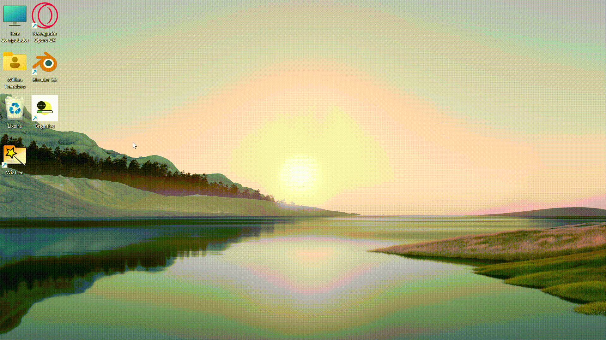

# Brightive v1.1

## About

This software allows you to customize your desktop theme. Whether your environment is too bright or too dark, Brightive automatically adjusts your desktop and applications to provide a more comfortable visual experience.

## Details

The program creates a folder in your AppData/Roaming directory. Inside this folder, there is a configuration file where you can adjust the brightness levels, including the minimum and maximum values.

If you set high values, your desktop will remain bright most of the time. However, if you set low values, your desktop will remain dark.

## Technical Details

- This program was developed in C# and designed to adapt your desktop theme and improve your workflow.

## Credits

*Willian Theodoro ([Willian-Thdr](https://github.com/Willian-Thdr))*

## Contact

*business.will.theo@gmail.com*